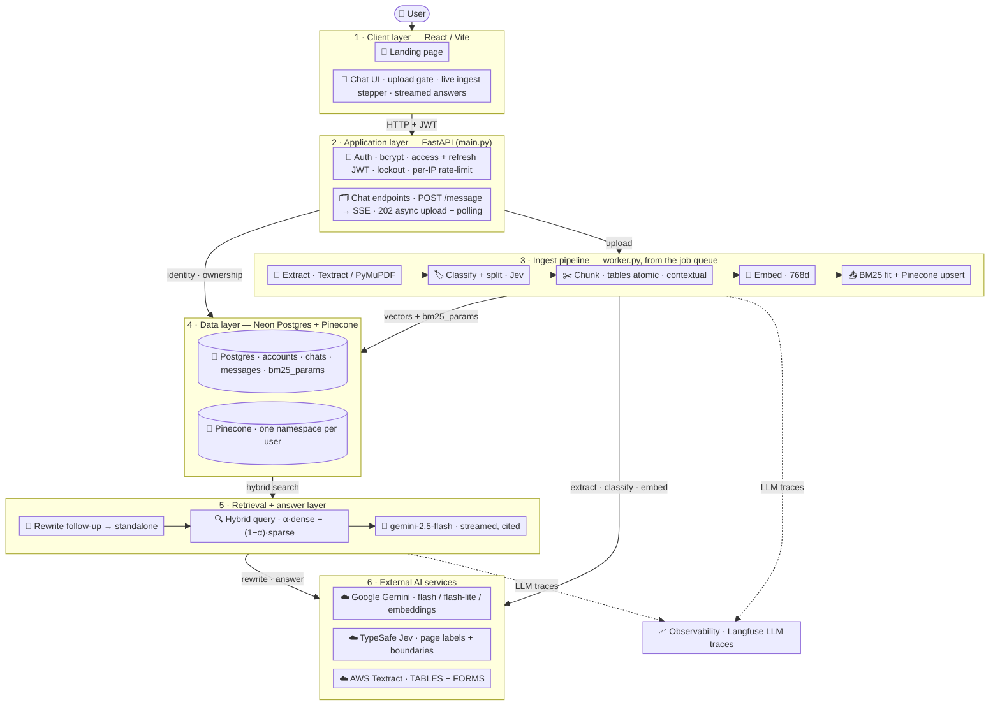

# 📄 Advanced Document Retrieval System

A **loan-file copilot** for home-loan (mortgage) officers: upload a borrower's packet, get an automatic review of the application against its supporting documents, record a decision on every flag, and ask anything else with page-cited answers. Under the hood it is a multi-user RAG (Retrieval-Augmented Generation) application for PDF documents. Built with a **React** frontend and a **FastAPI** backend, featuring accounts, persistent per-document conversations, open-source document extraction and hybrid sparse-dense search.

**One account → many chats → exactly one document each.** A chat session's id *is* its Pinecone namespace, so chat ↔ document ↔ namespace is 1:1. Neon/Postgres owns identity, ownership and conversation history; Pinecone holds only vectors.

---

## 🚀 Key Features

*   **Accounts & persistent chats**: JWT auth over bcrypt, DB-backed login lockout, and conversations that survive a restart — including their source citations. A login lasts **as long as the tab is open**: tokens live in `sessionStorage`, so a reload keeps you signed in, closing the tab signs you out, and a new tab asks you to log in.
*   **Session rehydration**: the in-process retriever is a pure cache. On a miss it rebuilds from Neon + Pinecone in **~11s** instead of re-ingesting the document (**~180s**), by persisting the fitted BM25 encoder and recomputing centroids from the index.
*   **Queued ingestion**: upload returns `202` and enqueues a job that a worker runs, with a pollable status — as its own process, or inside the API with `RUN_WORKER_IN_PROCESS=1`. A queued job is a row that outlives the API process, so a deploy or crash does not destroy work in flight.
*   **Pluggable Extraction**: **AWS Textract** (TABLES + FORMS, default) or **PyMuPDF** (local, no-AI, text-layer only) via `EXTRACT_METHOD`. Contextual chunking attaches each chunk's document identity so entity-specific queries stay unambiguous.
*   **Hybrid Search Engine**: A single **Pinecone** sparse-dense index holding `gemini-embedding-2` embeddings (768-dim) alongside **BM25** sparse vectors, fused by a tunable `alpha` (0.0 = pure keyword → 1.0 = pure semantic).
*   **Conversational follow-ups**: a follow-up like *"and when does it lock?"* is condensed into a standalone question **before retrieval**, because retrieval runs before any LLM sees a prompt. History is read server-side from Neon.
*   **Answer Generation**: **gemini-2.5-flash** with thinking capped at 2048 — on an ambiguous multi-candidate question it enumerates candidates with sources instead of guessing. Thinking tokens bill at the output rate, so the cap bounds the tail (dynamic permits 24,576) without touching the ~300-token median.
*   **Two decision paths**: page classification and boundary detection use **TypeSafe Jev** (closed-set choice and yes/no probability). Gemini flash-lite still handles per-document context lines and review field extraction; answers and query rewriting stay on flash.
*   **Automatic file review**: once a packet is ingested, the application's claims (income, employer, balances, declarations, loan terms) are checked against the pay slips, bank statement, Loan Estimate and title report. Each check shows both sides' values with their pages, in a panel beside the chat (a drawer on narrow screens) so the officer can ask about a flag without leaving it. See [Automatic file review](#-automatic-file-review).
*   **Use your own provider**: Settings lets a user choose Gemini (API key) or Cloudflare Workers AI (account ID and API token). Credentials are validated before they are kept in the browser tab, sent only with questions, and never stored by the server. Question rewriting and answers use the selected provider without spending daily credits; uploads and retrieval embeddings still use the app's keys. Without own credentials, the app's daily cap applies.
*   **Flag decisions with an audit trail**: every mismatch or review flag can be **accepted** (a note is required) or **confirmed** as an issue. Decisions are append-only, record who decided and when, and the sidebar counts open flags per borrower.
*   **Several PDFs per borrower**: upload up to 20 files at once; they are merged, in order, into the file's one document.
*   **Grounded answers**: values are quoted exactly with their document and page, never computed or rounded; a question the file cannot answer gets "not in the documents", not a guess. Summaries use their own rules.
*   **Semantic Routing**: Automatic query routing to specific document sections via embedding centroids — no extra LLM call.


---

## 🧾 Automatic file review

A loan officer's core check is *stare and compare*: the application holds the borrower's **claims**, the supporting documents are the **evidence**. The review does that comparison for every file, and the ingest **worker** runs it right after the document turns `ready`.

1. **Classify and split** the packet into documents (16 types, including **Loan Application**).
2. **Extract a fixed set of fields** per document type: first from Textract's FORMS label/value pairs, then **one flash-lite call per document** for anything missing and for lists (deposits, debits, liabilities, liens, easements).
3. **Grounding guard**: a model-extracted value is kept only if its exact text is found in that document, and its **page is located in code**, never taken from the model.
4. **Compare with rules in plain Python** (thresholds at the top of `core/review.py`), not with the LLM.

| Check | Compares |
|---|---|
| Income | stated monthly income vs pay slips (pay frequency from the slip or its period dates), 5% tolerance |
| Employer | application vs pay slip |
| Checking balance | stated vs statement ending balance, 10% tolerance |
| Payroll deposits | statement deposits vs pay-slip net pay |
| Large deposits | non-payroll deposits above 25% of monthly income vs the declaration |
| Loan amount, purchase price | application vs Loan Estimate |
| Stated debt payments | stated monthly payments vs statement debits |
| Liens, easements | title report; "payoff required" read from the report's own wording |
| Packet contents | Loan Application, Pay Slip and Bank Statement are noted when absent; comparisons needing absent documents are skipped, not called failed |

Each check is **mismatch**, **review**, **missing**, **match** or **info**. Documents absent from the packet are informational, not a loan-completeness verdict. The original uploaded/merged PDF is retained separately for an owner-only preview available as soon as upload completes. Swipe left/right or use arrow buttons to view its pages; review evidence opens the cited page. Older chats uploaded before this feature have no original to show. A review that fails is stored as failed and never fails the upload: the document stays searchable. If a worker is killed mid-review, the job's lease brings it back and the review is rebuilt; a review left on `running` with no job able to finish it is marked failed ("re-upload to review") by the worker's periodic check, so the panel never spins forever.

**Try it:** `samples/synthetic_borrower/whitfield_loan_packet.pdf` is an 8-page synthetic packet with five logical documents and planted issues. `whitfield_3doc_packet.pdf` is a three-page alternative: loan application, loan estimate, then bank statement. `answer_key.md` covers the 8-page packet's review and 35 test questions. Regenerate both with `python samples/synthetic_borrower/make_samples.py`.

### Citations and reliability

*   **Page numbers are 1-based everywhere a person or the model sees them.** Pages are stored 0-based; citations, the answer prompt and the eval prompt add 1. Before this, answers cited one page early. Pages are pages of the merged file when several PDFs were uploaded.
*   **The grounding guard ignores table cell separators**, so a value quoted from a table row (`07/15 | DIRECT DEP … | +$2,845.31`) still matches, and list values the model wraps as `{"value": …}` are unwrapped rather than dropped.
*   **With PyMuPDF, page-boundary detection reads table rows without their `|` separators**: with them, the model called a pay slip and the next bank statement "the same document" every time.
*   Provider calls retry 429s, 5xx and timeouts with full-jitter backoff behind a circuit breaker, and the worker stops claiming jobs while a provider is down (`llm/llm_router.py`, `worker.py`).

---

## 🏗️ Architecture

Six layers, read top to bottom. Each arrow is a hand-off between layers; the
ingest and retrieval pipelines flow left-to-right within their own band and the
bands stack one below the other, while the shared services (data, external AI)
are reached once per layer rather than by every stage, so the flow stays
legible. Observability is cross-cutting.



---

## 🛠️ Setup & Execution

### 1. Requirements
* **Node.js**: For the React frontend.
* **Python 3.10+**: For the FastAPI backend.
* **Neon (or any Postgres)**: Accounts, chat sessions and messages.
* **Pinecone**: Serverless index, `dimension=768`, `metric=dotproduct`.
* **Google AI API key**: `gemini-embedding-2` embeddings **and** `gemini-2.5-flash` answers.
* **AWS account** *(default extraction path)*: AWS Textract API (`AmazonTextractFullAccess` — or scoped to `textract:AnalyzeDocument`). Skip if you set `EXTRACT_METHOD=pymupdf` (local, no AWS calls).

### 2. Backend Setup
1.  Navigate to the backend directory:
    ```bash
    cd backend
    ```
2.  Install dependencies:
    ```bash
    pip install -r requirements.txt
    ```

### 3. Extraction Setup (AWS Textract)

PDF extraction runs on **AWS Textract** (TABLES + FORMS features), billed at **$0.065 per page** — about $3.25 for a 50-page packet. FORMS returns label/value pairs, which the file review uses before asking an LLM.

`EXTRACT_METHOD=pymupdf` reads the PDF's text layer locally, for free. It detects tables with PyMuPDF's `find_tables()` so they stay whole in chunking, but it **cannot read scanned pages** and returns no FORMS pairs. A PDF with no readable text on any page is rejected with a clear message; pages without text are listed in the file header ("No readable text on page 9. Not searched or reviewed.") instead of being indexed blank. Answers come from the Gemini API directly, so no self-hosted LLM server is required.

#### A. AWS
1.  Create an IAM user with `AmazonTextractFullAccess` (or a scoped policy granting `textract:AnalyzeDocument`).
2.  Generate an access key pair for that user.
3.  Set the credentials in `backend/.env` (see section E).

#### B. Pinecone
Create a serverless index with **`dimension=768`** and **`metric=dotproduct`** — dotproduct is required for sparse-dense hybrid queries, and the dimension must equal `EMBED_DIM` in `llm/llm_router.py`, which also drives the embedding call itself. The backend verifies both at startup and refuses to run on a mismatch, rather than failing minutes later at upsert.

#### C. Neon (Postgres)
Create a database and copy its **pooled** connection string (the `-pooler` host — PgBouncer multiplexes many client connections onto few backends, which a free-tier compute needs). Tables are prefixed `drs_` so this schema can share a database with other projects.

Create them with either:

```bash
# from backend/
python -c "from db.database import engine, Base; import db.models; Base.metadata.create_all(engine)"
# ...or paste migrations.sql into the Neon SQL editor
```

#### D. Configure `backend/.env`

Copy `backend/.env.example` to `backend/.env` and fill in your credentials.


### 4. Running the Backend and the Ingest Worker

Two processes: the API serves requests, the worker runs ingestion.

```bash
# API
python -m uvicorn main:app --app-dir backend --port 8000

# Ingest worker — in a second terminal
python backend/worker.py
```

**Or one process:** set `RUN_WORKER_IN_PROCESS=1` and only the API command is needed — the same worker runs on a background thread inside it, with the same queue, retries and fair ordering. On shutdown it stops claiming and gets 30s to finish; anything longer is picked up again through the job lease. What you give up is isolation: an API crash also pauses ingestion, and the two can't be scaled separately.

**Uploads queue but never finish without the worker running.** Ingestion is a
row in `drs_ingest_jobs`, not a background task inside the API, so a deploy or
crash of the API does not destroy work in flight — restarting the worker just
returns its jobs to the queue. `docker compose up` starts both.

Run more than one worker if ingest is the bottleneck: the claim is a conditional
`UPDATE ... FOR UPDATE SKIP LOCKED`, so a second worker takes different jobs
rather than duplicating the first one's.

### 5. Running the Frontend
1.  Navigate to the frontend directory:
    ```bash
    cd frontend
    ```
2.  Install dependencies:
    ```bash
    npm install
    ```
3.  Run Dev Server:
    ```bash
    npm run dev
    ```
4.  Open `http://localhost:5173`, create an account, then start a chat and upload a PDF.

Point a build at a deployed backend with `VITE_API_URL`:

```bash
VITE_API_URL=https://your-backend.onrender.com npm run build
```

---

## 🔌 API

Every endpoint except signup and login requires `Authorization: Bearer <token>`.

| Method | Path | Notes |
|---|---|---|
| `POST` | `/api/auth/signup` | → `{ token, user_id, username }` |
| `POST` | `/api/auth/login` | 5 failures / 15 min locks the username |
| `GET` | `/api/chats` | Sidebar list, newest first |
| `POST` | `/api/chats/new` | Reuses an existing empty chat |
| `GET` | `/api/chats/{id}` | Chat + full message history, the file review, the latest decision per flag and the decision history |
| `POST` | `/api/chats/{id}/document` | **202** — queues a job; the worker ingests it. One PDF or up to 20 under the same `file` field, merged in order |
| `GET` | `/api/chats/{id}/status` | Poll while `processing` |
| `POST` | `/api/chats/{id}/message` | Ask a question. Returns `question_asked` and `question_searched` so a rewritten follow-up is diagnosable |
| `PATCH` | `/api/chats/{id}` | Rename |
| `DELETE` | `/api/chats/{id}` | Drops the namespace **and** the rows. Flag decisions are kept (audit trail) |
| `GET` | `/api/account/credits` | `{cap, used, remaining}` for today; questions using own credentials are not counted |
| `POST` | `/api/account/check-key` | `{provider: "GEMINI"\|"CLOUDFLARE", key, account_id?}` — validates own credentials; Cloudflare checks the answer model with a small completion |
| `GET` | `/api/chats/{id}/pdf` | Owner-only original PDF; unavailable for pre-feature uploads |
| `GET` | `/api/chats/{id}/pdf/pages/{page}` | Owner-only PNG of a 1-based page; includes `X-PDF-Pages` count |
| `POST` | `/api/chats/{id}/review/decisions` | `{check_key, decision: accepted\|confirmed, note}`. Accept requires a note. **409** if the file has no finished review, **422** for an unknown flag |

### Request and response headers

| Header | Direction | Notes |
|---|---|---|
| `Idempotency-Key` | request | Optional, on `POST /document`. A resubmitted upload otherwise ingests twice and bills Textract twice. When absent the server derives a key from the chat id plus a hash of the bytes, so a double-tap or a client retry after a timeout is deduplicated with no client change. The response carries `duplicate: true` when a job was reused. |
| `X-Request-ID` | both | Echoed on every response. Send one to have it used as the correlation id; otherwise the server generates it. The same id is stored on the job row and adopted by the worker, so one value follows an upload across both processes. |
| `Retry-After` | response | Sent with every `429`, in seconds, derived from the limit that tripped. |
| `X-Gemini-Key` | request | Optional, on `POST /message`. Uses the user's Gemini key for rewrite and answer, without spending app credits. |
| `X-Cloudflare-Account-ID`, `X-Cloudflare-API-Token` | request | Optional pair, on `POST /message`. Uses the user's Cloudflare account for rewrite and answer, without spending app credits. Never send with `X-Gemini-Key`. |


**Chat lifecycle:** `awaiting_document → processing → ready | failed`

A chat that belongs to another user returns **404, not 403** — a 403 would confirm the id exists.

---

## 📈 Performance & Evaluation

The system's performance is validated using the **Ragas** evaluation framework, focusing on faithfulness, relevancy, and retrieval quality.

### 250-question evaluation — k=6 (generator `gemini-2.5-flash-lite`, judge `gemini-3.5-flash-lite`)

All three retrieval modes over the same corpus and models — raw per-question output in `results/ragas_k_6_{hybrid_new, vector_6, sparse_6}.csv`:

| Metric | Hybrid (α=0.4) | Vector (α=1) | Sparse (α=0) |
|---|---|---|---|
| Answer Correctness | **0.941** | 0.890 | 0.909 |
| Context Precision | 0.847 | 0.805 | **0.880** |
| Context Recall | **0.980** | 0.972 | 0.968 |
| Faithfulness | **0.979** | 0.954 | 0.963 |
| — | | | |
| Fully correct (AC = 1) | **222 / 250** | 207 / 250 | 210 / 250 |
| Partial (0 < AC < 1) | 21 / 250 | 25 / 250 | 27 / 250 |
| Wrong (AC = 0) | **7 / 250** | 18 / 250 | 13 / 250 |

**Hybrid wins on Answer Correctness, Context Recall, Faithfulness, and the fully-correct count**, and cuts the wrong-answer bucket to **7/250** — sparse alone leaves 13 wrong, vector alone leaves 18. Sparse edges hybrid only on `context_precision` (0.880 vs 0.847), because BM25 tends to fetch a tighter set of exact-keyword matches; the α=0.4 blend trades a bit of that precision for large gains everywhere else.

> [!NOTE]
> Evaluation was performed on a multi-document mortgage packet (21 logical documents across 50 pages). Raw per-question output for all configurations lives in `results/`.

---

## 📈 Observability

OpenTelemetry over OTLP exports provider-call spans to Langfuse when `LANGFUSE_PUBLIC_KEY` and `LANGFUSE_SECRET_KEY` are set. Each question has a `chat-message` trace with rewrite and answer calls nested beneath it, tagged with user and session. Ingest calls run in raw thread pools and appear as standalone traces. Set `LANGFUSE_HOST` to select the Langfuse endpoint; `OTEL_SERVICE_NAME` is optional. Tracing failures are logged and never break a request.

**Structured JSON logs with a correlation id** remain available without tracing. Every request gets one (an inbound `X-Request-ID` wins), and it is stored on the job row. The API upload and worker ingest therefore share a `request_id`. Set `LOG_FORMAT=text` for local output. Cost and token usage are recorded per provider call in these logs, including ingest calls without a parent trace.

---

## 🐳 CI/CD & Docker

`.github/workflows/ci.yml` runs on every push and PR:

1. **backend** — `ruff`, `compileall` and `core/review.py` (file-review rules and grounding guard), all with no network.
2. **frontend** — `npm ci`, `npm run lint`, `npm run build`.
3. **docker** — build both images (no push), so a broken Dockerfile fails here, not at deploy.
4. **deploy** — only after all three pass, only on push to `main`: POSTs the Render deploy hooks (`RENDER_DEPLOY_HOOK_*` secrets), skipping gracefully if they're unset.

`docker compose up --build` runs the stack locally: **three** services — `api` and `worker` from the same `backend/Dockerfile` (`python:3.12-slim`, non-root, `/api/health` probe) with different commands, plus `frontend/Dockerfile` (Vite build → nginx). Extraction runs on AWS Textract, so the backend image needs no GPU/GL libraries.

**Deploying needs the worker running somewhere.** Either a second service — the same image with `python worker.py` as its command (a Render **Background Worker**, which needs no public URL; it talks to the API only through the database) — or `RUN_WORKER_IN_PROCESS=1` on the API service, so one web service does both. Without either, uploads queue and are never processed — the API returns 202 and the chat sits on `processing` for ever.

The backend runs with `--forwarded-allow-ips *` (in the Dockerfile CMD) so slowapi's per-IP rate limits key on the real client (`X-Forwarded-For`) behind a proxy/balancer rather than the proxy's own IP — otherwise every user shares one rate-limit bucket. On a non-Docker deploy, set `FORWARDED_ALLOW_IPS=*` in the service env instead (uvicorn reads it).

---

## 📂 Project Structure

```text
document-retrieval-system/
├── backend/
│   ├── core/                        # Processing & retrieval engine
│   │   ├── document_store.py          # Orchestration + rehydrate()
│   │   ├── retriever.py               # Hybrid search, routing, namespaces
│   │   ├── pdf_processor.py           # AWS Textract integration (TABLES + FORMS)
│   │   ├── chunker.py                 # Structure-aware chunking
│   │   ├── document_classifier_jev.py # Active doc-type & boundary decisions (TypeSafe Jev)
│   │   ├── document_classifier_gemini.py # Previous Gemini implementation (inactive)
│   │   ├── query_rewriter.py          # Follow-up → standalone question
│   │   ├── answer_generator.py        # Grounded answer prompt
│   │   ├── review.py                  # Automatic file review: fields, grounding guard, rules
│   │   └── models.py                  # Core dataclasses
│   ├── db/                          # Neon / Postgres
│   │   ├── database.py                # Engine + session factory
│   │   └── models.py                  # accounts, chat_sessions (+ review), messages, review_decisions
│   ├── llm/
│   │   └── llm_router.py              # Gemini answers + embeddings
│   ├── eval/                        # Measurement harnesses
│   │   ├── model_sweep.py             # Generated questions, no judge (trust this)
│   │   ├── model_eval.py              # flash vs flash-lite, LLM-judged
│   │   └── prompt_eval.py             # Prompt-change A/B
│   ├── auth.py                      # JWT + bcrypt + refresh tokens
│   ├── observability.py             # OpenTelemetry → Langfuse
│   ├── main.py                      # API entry point
│   ├── worker.py                    # ingest worker — claims and runs queued jobs
│   ├── job_queue.py                 # the queue: enqueue / claim / finish / reclaim
│   ├── logging_setup.py             # JSON logs + correlation id
│   ├── Dockerfile                   # python:3.12-slim + uvicorn
│   ├── migrations.sql               # Schema + housekeeping queries
│   ├── requirements.txt
│   └── .env                         # Keys, DB URL, provider + queue settings
├── frontend/
│   ├── src/
│   │   ├── api.js                   # API client, owns the JWT
│   │   ├── Landing.jsx              # Animated landing page
│   │   ├── Login.jsx                # Login / signup
│   │   ├── ChatPanel.jsx            # Upload gate, live ingest stepper, messages, review panel
│   │   ├── App.jsx                  # Shell, auth gate, chat rail
│   │   └── App.css                  # Design tokens & styles
│   ├── Dockerfile                   # Vite build → nginx
│   └── nginx.conf                   # SPA routing
├── .github/workflows/ci.yml         # lint · build · docker · gated deploy
├── docker-compose.yml               # local api + frontend stack
├── ruff.toml
├── samples/synthetic_borrower/      # Synthetic loan packet + answer key for the review
├── results/                         # Ragas metrics (k=6 CSVs)
└── README.md
```

---

## 📜 License

MIT License